# Sistem Penjualan dan Inventaris TCG

## Deskripsi Program

Program ini merupakan sistem sederhana untuk mengelola penjualan dan inventaris toko kartu Trading Card Game (TCG), khususnya kartu Pokemon dan One Piece. Program mencakup pengelolaan data toko, data kartu beserta stoknya, data pelanggan, dan transaksi pembelian.

Class yang digunakan adalah `KartuTCG` (abstract class), `KartuPokemon`, `KartuOnePiece`, `Toko`, `Pelanggan`, `Transaksi`, `DetailTransaksi`, `PembayaranQRIS`, dan `PembayaranTunai`.

---

## 1. Relasi UML (Class Diagram)

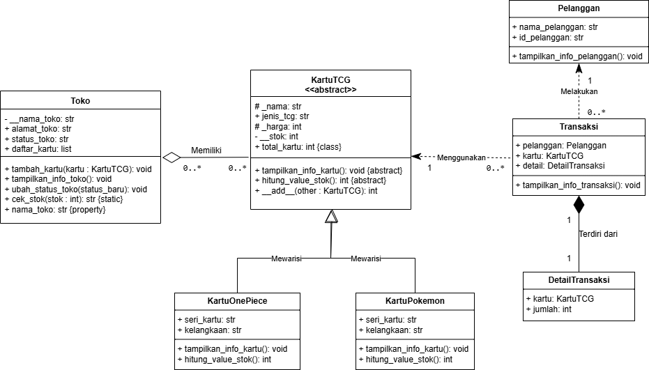

Diagram di atas menampilkan nama kelas, atribut dan method utama, serta garis relasi antar kelas. Setiap relasi pada diagram benar-benar diimplementasikan pada kode program.

**Asosiasi (`Transaksi` → `Pelanggan` dan `Transaksi` → `KartuTCG`)**
Objek `Pelanggan` dan `KartuTCG` dibuat di luar kelas `Transaksi`, kemudian diberikan melalui constructor dan disimpan pada atribut `self.pelanggan` dan `self.kartu`. Relasi ini berupa asosiasi karena pelanggan dan kartu merupakan objek yang berdiri sendiri dan tetap ada walaupun transaksi tidak ada.

**Agregasi (`Toko` ◇— `KartuTCG`)**
Kelas `Toko` menampung kumpulan kartu pada list `daftar_kartu` melalui method `tambah_kartu()`, sedangkan objek kartu dibuat di luar kelas `Toko`. Relasi ini dipilih sebagai agregasi karena apabila objek `Toko` dihapus, objek kartu tetap ada dan masih dapat digunakan oleh toko lain.

**Komposisi (`Transaksi` ◆— `DetailTransaksi`)**
Objek `DetailTransaksi` dibuat langsung di dalam constructor kelas `Transaksi`. Relasi ini dipilih sebagai komposisi karena detail transaksi (kartu dan jumlah) tidak memiliki arti tanpa transaksinya, sehingga siklus hidupnya bergantung penuh pada `Transaksi`.

**Pewarisan (`KartuPokemon` dan `KartuOnePiece` → `KartuTCG`)**
Kedua kelas tersebut merupakan subclass dari `KartuTCG`.

---

## 2. Abstraksi (Abstract Base Class)

Kelas `KartuTCG` dibuat menggunakan `ABC` dengan rincian sebagai berikut:

- Dua abstract method, yaitu `tampilkan_info_kartu()` dan `hitung_value_stok()`.
- Satu method konkret, yaitu `jalankan()`, yang digunakan bersama oleh seluruh subclass.

Subclass `KartuPokemon` dan `KartuOnePiece` mengimplementasikan seluruh abstract method tersebut. Konsep inheritance dari posttest sebelumnya tetap digunakan:

- Pemanggilan `super().__init__(...)` pada constructor setiap subclass.
- Atribut unik masing-masing subclass, yaitu `seri_kartu` dan `kelangkaan`.
- Atribut protected: `_nama` dan `_harga`.
- Atribut private: `__stok` (diakses melalui property) dan `__nama_toko`.

### Bukti Abstract Class Tidak Dapat Diinstansiasi

Objek `KartuTCG` dicoba dibuat secara langsung di dalam blok `try-except TypeError`.

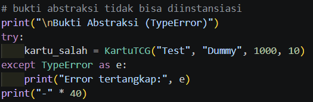

**Output:**

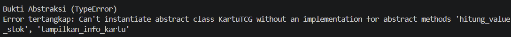

**Keterangan:**
Kesalahan `TypeError` muncul saat objek dibuat, bukan saat method dipanggil. Dengan demikian, kelas yang implementasinya belum lengkap dapat terdeteksi sejak awal.

---

## 3. Polimorfisme

### a. Polimorfisme melalui Pewarisan

Method `tampilkan_info_kartu()` dan `hitung_value_stok()` di-override oleh `KartuPokemon` dan `KartuOnePiece`. Kedua method dipanggil melalui satu perulangan yang berisi objek dari dua subclass berbeda.

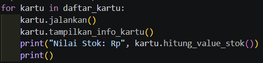

**Keterangan:**
Pada perulangan `for kartu in daftar_kartu` tidak terdapat pengecekan jenis kartu. Python memilih method milik masing-masing subclass pada saat program dijalankan.

### b. Duck Typing

Kelas `PembayaranQRIS` dan `PembayaranTunai` tidak memiliki hubungan pewarisan, tetapi keduanya memiliki method `proses_pembayaran()`. Kedua objek dipanggil melalui fungsi yang sama, yaitu `bayar_pesanan()`.

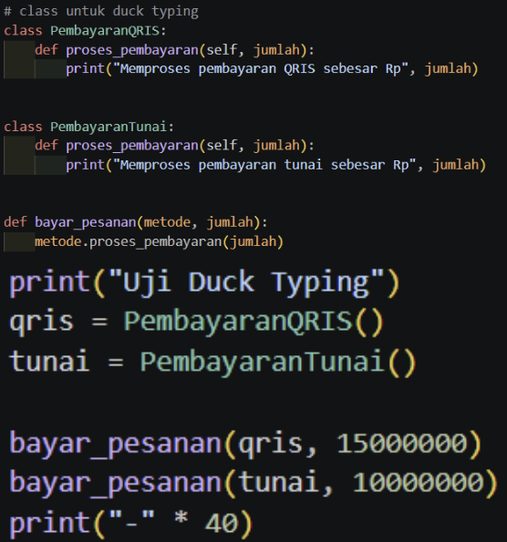

**Output:**
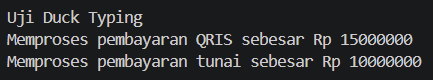

**Keterangan:**
Fungsi `bayar_pesanan()` tidak bergantung pada tipe objek, melainkan pada keberadaan method `proses_pembayaran()`.

### c. Operator Overloading

Kelas `KartuTCG` mendefinisikan method `__add__()` sehingga dua objek kartu dapat dijumlahkan menggunakan operator `+`.

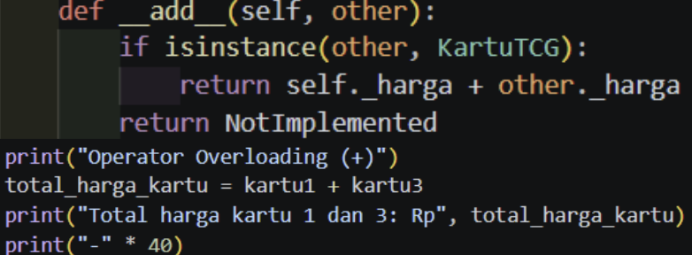

**Output:**
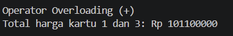

**Keterangan:**
Ekspresi `kartu1 + kartu3` menghasilkan jumlah harga kedua kartu, yaitu Rp 101.100.000.

### d. Larangan Anti-Pattern

Program ini tidak menggunakan rantai `if` / `elif` yang memeriksa `type()` atau string jenis kartu untuk membedakan perilaku objek. Setiap objek menentukan perilakunya sendiri melalui method. Fungsi `isinstance()` hanya digunakan pada `__add__()` untuk memastikan kedua operand merupakan kartu.

---

## 4. Pengujian Fitur Lainnya

Bagian ini menguji fitur lain yang ada di program, yaitu relasi antar objek, class method, static method, dan property. Setiap pengujian terdiri dari kode yang dijalankan, output program, dan keterangan hasilnya.

### a. Pengujian Relasi (Agregasi, Asosiasi, dan Komposisi)

Pengujian ini menunjukkan ketiga relasi pada diagram berjalan di kode. Kartu dimasukkan ke dalam toko (agregasi), lalu objek `Transaksi` dibuat dari pelanggan dan kartu (asosiasi) yang secara otomatis membuat `DetailTransaksi` di dalamnya (komposisi).

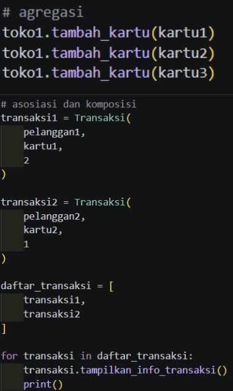

**Output:**
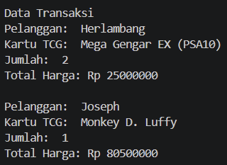

**Keterangan:**
Setiap transaksi menampilkan nama pelanggan, nama kartu, jumlah, dan total harga. Total harga dihitung dari harga kartu dikalikan jumlah pembelian yang tersimpan di `DetailTransaksi`.

### b. Pengujian Class Method dan Static Method
 
Method `ubah_status_toko()` adalah class method yang mengubah atribut class `status_toko`. Method `cek_stok()` adalah static method yang tidak memakai `self` maupun `cls`.

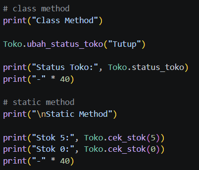

**Output:**
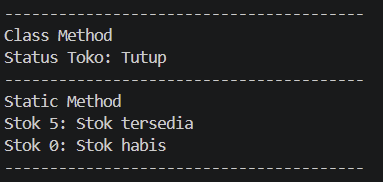

**Keterangan:**
Status toko berubah menjadi "Tutup" untuk seluruh toko karena menggunakan atribut class. Method `cek_stok()` mengembalikan "Stok tersedia" apabila stok lebih dari 0 dan "Stok habis" apabila stok 0.

### c. Pengujian Property Getter dan Setter

Atribut `__stok` bersifat private sehingga diakses melalui property `stok`. Setter memvalidasi bahwa stok tidak boleh negatif.

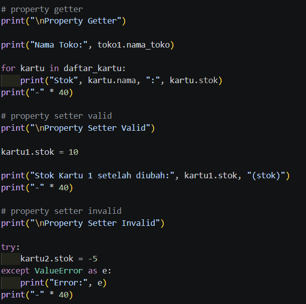

**Output:**
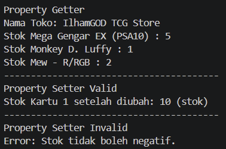

**Keterangan:**
Stok kartu 1 berhasil diubah menjadi 10 karena nilainya valid. Ketika stok kartu 2 diisi `-5`, program menampilkan `ValueError` ("Stok tidak boleh negatif.") dan nilai stok sebelumnya tetap tersimpan.

---

## Prinsip SOLID

**Open/Closed Principle (OCP)**
Fungsi `bayar_pesanan()` tidak perlu diubah ketika terdapat metode pembayaran baru. Cukup dibuat kelas baru yang memiliki method `proses_pembayaran()`, misalnya pembayaran transfer bank, tanpa mengubah kode yang sudah ada.